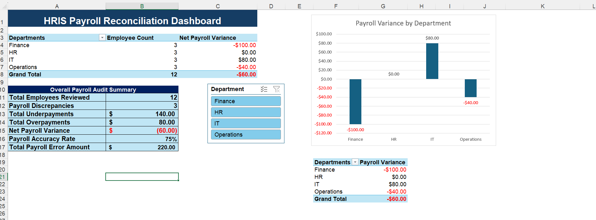

# HRIS Payroll Reconciliation Dashboard

## Project Overview
This project demonstrates payroll reconciliation and HRIS data analysis using Microsoft Excel and fictional employee records.

The objective is to identify discrepancies between approved employee pay rates and actual payroll rates, calculate their financial impact, and summarize findings by department.

## Dashboard Preview

## Tools and Skills

- Microsoft Excel
- XLOOKUP and IF formulas
- COUNTIF, COUNTIFS, SUMIF, and SUMIFS
- PivotTables and slicers
- Payroll reconciliation and data validation

## Key Findings
The fictional payroll dataset contains 12 employee records across four departments.

- **3 employees** had mismatched hourly pay rates.
- **$140** in potential employee underpayments was identified.
- **$80** in potential overpayments was identified.
- **$60** was the net payroll shortfall.

## Departmental Results

| Department | Employees | Net Payroll Difference |
|---|---:|---:|
| Finance | 3 | -$100 |
| HR | 3 | $0 |
| IT | 3 | +$80 |
| Operations | 3 | -$40 |
| **Total** | **12** | **-$60** |

## Business Value
This project demonstrates how Excel can support payroll accuracy, identify discrepancies, and provide management with department-level reporting.

## Data Privacy
All employee and payroll information used in this project is fictional and intended for educational and portfolio purposes.
